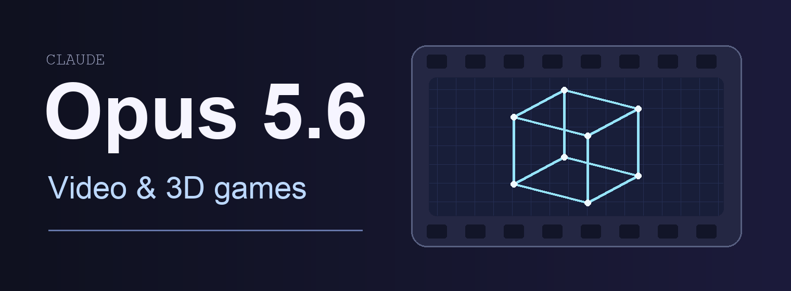

# Vídeo, animación y juegos 3D con Claude Opus 5.6

## 🍌 Introducción

Una selección de vídeos, animaciones y juegos 3D hechos con código que la comunidad atribuye a Claude Opus 5.6. Las publicaciones aparecieron durante una prueba limitada.

## 📊 Resumen

**10 casos · 7 ejemplos de vídeo y animación · 3 ejemplos de juegos 3D.**

> [!NOTE]
> Cada caso indica la fuente, la cuenta, la fecha y las pruebas disponibles. Un vídeo de juego o un tráiler por sí solo no demuestra que se pueda jugar.

## ⚡ Inicio rápido

Elige un caso del índice y abre la publicación original para ver el ejemplo y leer el relato de su autor.

[Índice](#menu)

## 📑 Índice

| Caso | Categoría | Qué muestra | Tipo |
|---|---|---|---|
| [The Tea Ride](#case-1) | Vídeo y animación | Observa cómo un corto de Three.js mantiene una escena durante 82 segundos. | Demostración |
| [Fénix sobre las nubes](#case-2) | Vídeo y animación | Observa cómo se mueve un personaje de gran tamaño en este corto hecho con código. | Demostración |
| [Comparativa de un bucle SVG con un zorro](#case-3) | Vídeo y animación | Compara en paralelo el movimiento y el cierre del bucle. | Evaluación |
| [Canto sintetizado por código](#case-4) | Vídeo y animación | Escucha cómo se combinan la voz sintetizada y las imágenes. | Demostración |
| [Animación de un observatorio en Python](#case-5) | Vídeo y animación | Úsala como ejemplo de animación dibujada fotograma a fotograma en Python. | Demostración |
| [Máquina de caligrafía](#case-6) | Vídeo y animación | Fíjate en la difusión de la tinta y en el enfoque. | Limitación |
| [Despiece de un reloj mecánico](#case-7) | Vídeo y animación | Mira cómo se separan y vuelven a unir las piezas. | Demostración |
| [Mundo de vóxeles en un archivo HTML](#case-8) | Juegos 3D | Observa la iluminación y el movimiento en este mundo de vóxeles. | Demostración |
| [Juego en primera persona con Three.js](#case-9) | Juegos 3D | Observa el movimiento y la presentación del nivel. | Demostración |
| [Tráiler de defensa de torres](#case-10) | Juegos 3D | Usa el tráiler para observar la dirección visual. | Demostración |

[Resumen](#overview) · [Inicio rápido](#quick-start) · [Repositorios relacionados](#related-repositories) · [Agradecimientos](#acknowledge)

## 🎬 Vídeo y animación

### Caso 1: [The Tea Ride](https://x.com/chetaslua/status/2125253343480275008) (by [@chetaslua](https://x.com/chetaslua))

**Observa cómo un corto de Three.js mantiene una escena durante 82 segundos.**

La publicación muestra la animación y dice que se hizo sin recursos externos.

**Atribución del modelo:** La cuenta que publicó el ejemplo menciona Opus 5.6. La versión exacta queda por verificar.

Type: Demostración | Date: 2026-11-24

---

### Caso 2: [Fénix sobre las nubes](https://x.com/chetaslua/status/2125226204764733481) (by [@chetaslua](https://x.com/chetaslua))

**Observa cómo se mueve un personaje de gran tamaño en este corto hecho con código.**

La publicación muestra un fénix animado y describe el resultado como código puro.

**Atribución del modelo:** La cuenta que publicó el ejemplo menciona Opus 5.6. La versión exacta queda por verificar.

Type: Demostración | Date: 2026-11-24

---

### Caso 3: [Comparativa de un bucle SVG con un zorro](https://x.com/marcthecreatorr/status/2125254550416175477) (by [@marcthecreatorr](https://x.com/marcthecreatorr))

**Compara en paralelo el movimiento y el cierre del bucle.**

La cuenta dice que ambas versiones recibieron el mismo prompt. El vídeo muestra una sola comparación.

**Atribución del modelo:** La cuenta que publicó el ejemplo menciona Opus 5.6. La versión exacta queda por verificar.

Type: Evaluación | Date: 2026-11-24

---

### Caso 4: [Canto sintetizado por código](https://x.com/chetaslua/status/2125288009990103316) (by [@chetaslua](https://x.com/chetaslua))

**Escucha cómo se combinan la voz sintetizada y las imágenes.**

La cuenta afirma que el audio y lo visual se hicieron con código y que no usó síntesis de texto a voz.

**Atribución del modelo:** La cuenta que publicó el ejemplo menciona Opus 5.6. La versión exacta queda por verificar.

Type: Demostración | Date: 2026-11-24

---

### Caso 5: [Animación de un observatorio en Python](https://x.com/LeeLinAI123/status/2125403314221142191) (by [@LeeLinAI123](https://x.com/LeeLinAI123))

**Úsala como ejemplo de animación dibujada fotograma a fotograma en Python.**

La cuenta dice que Python dibujó todos los fotogramas sin otro modelo de imagen o vídeo.

**Atribución del modelo:** La cuenta que publicó el ejemplo menciona Opus 5.6. La versión exacta queda por verificar.

Type: Demostración | Date: 2026-11-25

---

### Caso 6: [Máquina de caligrafía](https://x.com/lemomo_ai/status/2125250592243155013) (by [@lemomo_ai](https://x.com/lemomo_ai))

**Fíjate en la difusión de la tinta y en el enfoque.**

La cuenta describe un solo intento y señala problemas de enfoque y ausencia de difusión de la tinta.

**Atribución del modelo:** La cuenta que publicó el ejemplo menciona Opus 5.6. La versión exacta queda por verificar.

Type: Limitación | Date: 2026-11-24

---

### Caso 7: [Despiece de un reloj mecánico](https://x.com/lucian__03/status/2125364841858953393) (by [@lucian__03](https://x.com/lucian__03))

**Mira cómo se separan y vuelven a unir las piezas.**

El vídeo muestra engranajes, un mecanismo de resorte y la secuencia de despiece y montaje.

**Atribución del modelo:** La cuenta que publicó el ejemplo menciona Opus 5.6. La versión exacta queda por verificar.

Type: Demostración | Date: 2026-11-24

---

## 🎮 Juegos 3D

### Caso 8: [Mundo de vóxeles en un archivo HTML](https://x.com/intheworldofai/status/2125385407806284196) (by [@intheworldofai](https://x.com/intheworldofai))

**Observa la iluminación y el movimiento en este mundo de vóxeles.**

La publicación describe un archivo HTML con varios modos de juego. La evidencia disponible es una grabación.

**Atribución del modelo:** La cuenta que publicó el ejemplo menciona Opus 5.6. La versión exacta queda por verificar.

Type: Demostración | Date: 2026-11-25

---

### Caso 9: [Juego en primera persona con Three.js](https://x.com/RezAIT00/status/2125368341002924390) (by [@RezAIT00](https://x.com/RezAIT00))

**Observa el movimiento y la presentación del nivel.**

La cuenta dice que usó Three.js y tardó tres horas. Queda por verificar si el juego se puede jugar.

**Atribución del modelo:** La cuenta que publicó el ejemplo menciona Opus 5.6. La versión exacta queda por verificar.

Type: Demostración | Date: 2026-11-24

---

### Caso 10: [Tráiler de defensa de torres](https://x.com/Mr_Salio/status/2125222399809409109) (by [@Mr_Salio](https://x.com/Mr_Salio))

**Usa el tráiler para observar la dirección visual.**

La cuenta dice que obtuvo un prototipo jugable con un prompt de 20 palabras. El material vinculado es un tráiler.

**Atribución del modelo:** La cuenta que publicó el ejemplo menciona Opus 5.6. La versión exacta queda por verificar.

Type: Demostración | Date: 2026-11-24

---

## 🔗 Repositorios relacionados

[Colección relacionada de casos de Claude Opus 5.5](https://github.com/cheercheung/awesome-claude-opus-5-5-usecases)

## 🙏 Agradecimientos

Gracias a las cuentas que compartieron los ejemplos.

[@chetaslua](https://x.com/chetaslua), [@marcthecreatorr](https://x.com/marcthecreatorr), [@LeeLinAI123](https://x.com/LeeLinAI123), [@lemomo_ai](https://x.com/lemomo_ai), [@lucian__03](https://x.com/lucian__03), [@intheworldofai](https://x.com/intheworldofai), [@RezAIT00](https://x.com/RezAIT00), [@Mr_Salio](https://x.com/Mr_Salio)

Abre una incidencia para corregir una atribución o solicitar la retirada de un caso.
